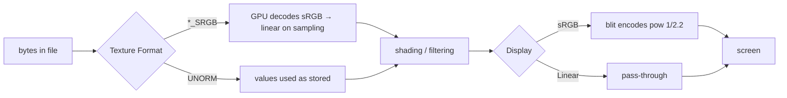

# Color space

How the viewer treats sRGB and linear data, from loading and converting to what reaches the screen.

## sRGB vs linear data

- **sRGB-encoded** values are stored on a perceptual (roughly gamma 2.2) curve, so more of the 256 levels go to
  dark tones. Color images such as albedo, UI art and photos are almost always sRGB. **PNG and JPEG files are
  sRGB-encoded.**
- **Linear** values are proportional to light, or aren't colors at all: normal maps, roughness, metalness, masks
  and height maps. They must be used as-is.

A GPU **sRGB texture format** (e.g. `RGBA8_UNORM_SRGB`, `BC7_RGBA_UNORM_SRGB`) decodes sRGB → linear in hardware
when sampled. A **UNORM** format returns the stored values unchanged.

## Color space in KTX2 files

A KTX2 file records its color space in two places:

- The **vkFormat**: `*_SRGB` formats, e.g. `R8G8B8A8_SRGB` or `ASTC_6x6_SRGB_BLOCK`, are sRGB.
- The **DFD transfer function** (OETF), exposed by ris-ktx2 as `oetf` (`KtxDFTransfer.SRGB` / `LINEAR`). Basis
  Universal files (ETC1S / UASTC) have vkFormat `UNDEFINED`, so for them this is the only source.

### Convert dialog: "sRGB (color data)"

When checked, the source image is created as `R8G8B8A8_SRGB` instead of `R8G8B8A8_UNORM`. libktx carries that
into the output:

| Encoding        | Output marked as sRGB by                    |
|-----------------|---------------------------------------------|
| Uncompressed    | vkFormat `R8G8B8A8_SRGB`                    |
| UASTC / ETC1S   | DFD transfer function sRGB                  |
| ASTC            | vkFormat `ASTC_*_SRGB_BLOCK`                |

Check it for color textures, and leave it off for data maps. ASTC "Normal map" mode turns it off, because normal
maps are linear. The option only changes how the file is labeled. The pixel bytes are the same either way.

## Texture Format (per texture)

Each texture has its own format in the Inspector's **Texture Format** picker, next to "Generate mipmaps". Every
format is listed as its **sRGB** (`*_SRGB`) and **linear** (`UNORM`) variant:

- **Images (PNG/JPEG):** `RGBA8_UNORM_SRGB` (default) or `RGBA8_UNORM`.
- **KTX2, uncompressed or a fixed compressed format:** the file's format in both variants. The bytes are the
  same and are only read differently (the framework's `createFromKtx2` with an explicit format).
- **KTX2 Basis (ETC1S / UASTC):** RGBA8 and every transcode target the GPU supports (BC7, ASTC 4x4, BC3,
  ETC2), each in both variants.
- **Formats without an sRGB variant** (PVRTC) get a single entry.

By default, images use sRGB and KTX2 files use their own color space (the variant that matches the file). The pick
is stored on the texture and kept when you toggle mipmaps or switch WebGL2 ↔ WebGPU.

An `*_SRGB` format makes the GPU decode sRGB → linear when sampling. A `UNORM` format returns the stored values.
Use sRGB for color textures and linear for data maps (normal, roughness, masks).

## The Display switch (Inspector → Display color space)

**sRGB** (default) or **Linear**. It only sets the renderer output, for all textures, and doesn't change any
texture's format:

- **sRGB** → `renderer.outputColorSpace = OutputColorSpace.SRGB`. The framework's blit shader encodes the linear
  result to sRGB on present.
- **Linear** → `OutputColorSpace.NONE`. There's no conversion, and values go to the screen as they are.

It is applied when the framework is created (including after a WebGL2 ↔ WebGPU switch) and live when you toggle it.
It is saved in localStorage (`ris-ktx2-viewer.displayColorSpace`). The background clear color is `0.8^2.2`
(linear) under sRGB output and `0.8` under no conversion, so it shows the same gray in both.

| Texture format | Display | In the shader          | Output              | On screen                                  |
|----------------|---------|------------------------|---------------------|--------------------------------------------|
| `*_SRGB`       | sRGB    | linear (decoded)       | encoded to sRGB     | ≈ the original sRGB bytes (color-managed)  |
| `UNORM`        | Linear  | stored bytes           | as-is               | the stored bytes, exactly                  |
| `*_SRGB`       | Linear  | linear (decoded)       | as-is               | too dark (decoded but never re-encoded)    |
| `UNORM`        | sRGB    | stored bytes           | encoded to sRGB     | too bright / washed out (encoded twice)    |

### Which combination to use

- **Color textures:** `*_SRGB` format with Display **sRGB**. This is the color-managed path: filtering and
  blending happen in linear space, as in an sRGB-correct engine.
- **Exact values or data maps:** `UNORM` format with Display **Linear**. Pixel values on screen match the file
  bit for bit.
- The mixed combinations are useful for checking which color space a texture's data is really in: if it looks
  right with the "wrong" pairing, the file is probably labeled wrong.

## Inspector: "File color space"

This row shows what the file declares, not how it is displayed:

- **KTX2**: "sRGB (color)" or "Linear (data)" from the DFD transfer function, or else from the vkFormat name
  (`*_SRGB`), or else Linear. This includes Basis files.
- **Images (PNG/JPEG)**: always "sRGB (color)".

## Known limitations

- **Mipmaps aren't gamma-correct for sRGB.** Mip generation in the conversion (ris-framework
  `generateMipmapsAsync`) averages the sRGB-encoded values directly, so lower mips of sRGB textures come out
  slightly dark. To be fixed in the framework.
- **Dark tones with sRGB output.** The framework's main render target is `RGBA8_UNORM`, which stores 8-bit linear
  values, so sRGB values below about 13/255 collapse into a few steps. The output encode is also
  `pow(c, 1/2.2)`, not the exact sRGB curve. As a result, very dark gradients can look slightly lifted or banded
  next to the original. Linear output with UNORM textures is unaffected. To be fixed in the framework: an sRGB or float render target
  and the exact sRGB encode.
